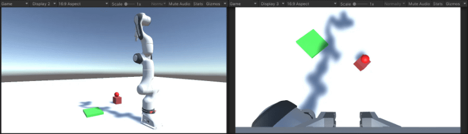

# Unity3d-robotics-simulation-VLA

This repository contains a Unity simulation for the **Franka FR3** robot, designed for robotic manipulation tasks such as picking up a ball and placing it into a container. 



This simulation acts as the client environment, capturing visual data (such as camera images) and robot state data (such as joint poses). This data is transmitted to a cloud server running an inference engine to predict the next optimal robot action. The simulator then receives the response and executes the predicted actions in real-time.

---

## 1. Installing Docker in WSL (Without Docker Desktop)

Docker is required to generate the URDF files for the Franka robot before importing them into Unity3D.
If you are running WSL2 without Docker Desktop, follow these instructions to install Docker directly inside your Linux terminal:

```bash
# Add Docker's official GPG key:
sudo apt-get update
sudo apt-get install ca-certificates curl
sudo install -m 0755 -d /etc/apt/keyrings
sudo curl -fsSL https://download.docker.com/linux/ubuntu/gpg -o /etc/apt/keyrings/docker.asc
sudo chmod a+r /etc/apt/keyrings/docker.asc

# Add the repository to Apt sources:
echo
  "deb [arch=$(dpkg --print-architecture) signed-by=/etc/apt/keyrings/docker.asc] https://download.docker.com/linux/ubuntu \
  $(. /etc/os-release && echo "${UBUNTU_CODENAME:-$VERSION_CODENAME}") stable" | sudo tee /etc/apt/sources.list.d/docker.list > /dev/null
sudo apt-get update

# Install Docker packages:
sudo apt-get install docker-ce docker-ce-cli containerd.io docker-buildx-plugin docker-compose-plugin

# Add your user to the Docker group
sudo usermod -aG docker $USER

If the docker group wasn’t created automatically:
sudo addgroup docker
```

## 2. Creating the URDF formats for the Robots

Clone the official Franka description repository: [franka_description](https://github.com/frankarobotics/franka_description/tree/main
)

Before running the creation script, fix potential Windows/WSL line-ending carriage return issues (\r), assign execution permissions, and generate the URDF for the fr3 model:

```Bash
chmod +x ./scripts/create_urdf.sh
sed -i -e 's/\r$//' ./scripts/create_urdf.sh

sed -i -e 's/\r$//' .docker/create_urdf.entrypoint.sh
chmod +x .docker/create_urdf.entrypoint.sh

sudo ./scripts/create_urdf.sh fr3
```

## 3. Importing into Unity

First, Install the official Unity URDF Importer package. Refer to the Unity URDF Importer Guide for details [here](https://github.com/Unity-Technologies/URDF-Importer)

Place your generated description package (from step 2) inside your Unity project structure under Assets/:

```
Assets/
└── franka_description/
    ├── meshes/
    ├── robots/
    └── fr3_franka_hand.urdf
```

## 4. Franka FR3 Unity Simulation Setup & Stabilization

To ensure physical stability, eliminate jitter, and configure clean interactive controls in Unity, apply the following settings:

* **Anchor Base Link:** Set fr3_link0 as Immovable in its `ArticulationBody` component to anchor the robot securely to the ground.
* **Optimize Physics Solver:** Increase physics stability by setting **Default Solver Iterations** to 15 and **Solver Velocity Iterations** to 10 in `Edit > Project Settings > Physics`.
* **Eliminate Self-Collisions:** 
    * Assign a custom **Robot** layer to the root `fr3` object and apply it to all children.
    * Go to `Edit > Project Settings > Physics`, locate the **Layer Collision Matrix**, and uncheck the intersection where **Robot** meets **Robot** to prevent adjacent links from colliding and jittering.
* **Tune Controller Parameters:** Configure the built-in `Controller` component settings for smooth articulation drives:
    * **Stiffness:** `10000`
    * **Damping:** `1000`
    * **Force Limit:** `1000`
    * **Speed:** `30` (or `45`)
    * **Joint Friction:** Lowered the default joint friction value from `10` to `1` in the URDF Importer package script (`Packages/com.unity.robotics.urdf-importer/Runtime/Controller/Controller.cs`) by setting `defJointFriction = 1;`.

* **Removing Colliders from Hand and Fingers:** By default, the URDF importer generates convex mesh colliders for the hand and fingers that wrap around the empty gap between the fingers, making the collision bounds larger than the actual mesh. Because of this, the gripper pushed the ball away before physically touching it. I manually disabled these colliders in the Hierarchy.

* **Camera Setup:** Set up two cameras—one mounted on the robot's wrist and another positioned at the front-left of the workspace (so the entire region, including the robot, ball, and target platform, remains visible). The camera properties are configured as follows:
    * **Wrist Camera:** Placed on the wrist as a child of `fr3_hand`
        * `Clipping Planes: Near = 0.02 (2 cm)` (To Ensure the robot's fingertips and the ball do not get clipped out of camera's view when the gripper approaches closely before grasping)
        * `Field of View = 60`
        * `Projection : Perspective`
    * **External Camera**
        * `Clipping Planes: Near = 0.1 (10 cm)`
        * `Field of View = 60`
        * `Projection : Perspective`
    
## 5. Synthetic Data Collection (SDC)

I created a C# control script to move the robot through a predefined sequence of joint angles: from the starting pose, to the grasping pose, and finally to the placing pose. This was done to ensure our robotic arm is set up correctly before we start working with inverse kinematics. For this initial test, fixed joint configurations corresponding to the known positions of the ball and platform were hardcoded to verify automated pick-and-place execution. The next step is to implement Inverse Kinematics (IK) so the robot can dynamically locate a randomly placed ball, grasp it, lift it, and place it onto the platform. Together, these steps define our synthetic data collection pipeline.
