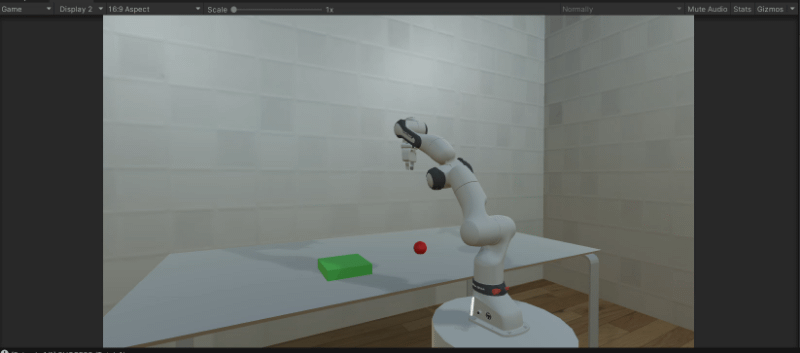
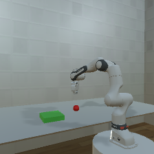
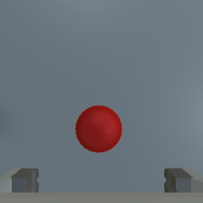
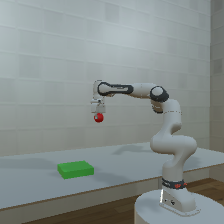
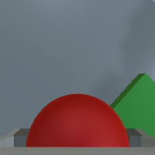
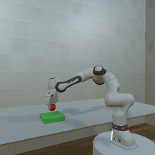
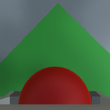

# Unity3d-Franka-FR3-Robotics-Simulation-VLA


This repository contains a Unity simulation for the **Franka FR3** robot, designed for robotic manipulation tasks such as picking up a ball and placing it into a container. 



You can download the dataset of 306 Episodes from Hugging Face repo : [Franka-FR3-Unity3d-Simulation-Ball-Pick-And-Place](https://huggingface.co/datasets/wasil11/Franka-FR3-Unity3d-Simulation-Ball-Pick-And-Place)

This simulation acts as the client environment, capturing visual data (such as camera images) and robot state data (such as joint poses). This data is transmitted to a cloud server running an inference engine to predict the next optimal robot action. The simulator then receives the response and executes the predicted actions in real-time.

**Note:** The collected Franka FR3 manipulation dataset (formatted for LeRobot and π₀ fine-tuning) will be published on Hugging Face soon.

---

## 1. Installing Docker in WSL (Without Docker Desktop)

Docker is required to generate the URDF files for the Franka robot before importing them into Unity3D.
If you are running WSL2 without Docker Desktop, follow these instructions to install Docker directly inside your Linux terminal:

```bash
# Add Docker's official GPG key:
sudo apt-get update
sudo apt-get install ca-certificates curl
sudo install -m 0755 -d /etc/apt/keyrings
sudo curl -fsSL https://download.docker.com/linux/ubuntu/gpg -o /etc/apt/keyrings/docker.asc
sudo chmod a+r /etc/apt/keyrings/docker.asc

# Add the repository to Apt sources:
echo
  "deb [arch=$(dpkg --print-architecture) signed-by=/etc/apt/keyrings/docker.asc] https://download.docker.com/linux/ubuntu \
  $(. /etc/os-release && echo "${UBUNTU_CODENAME:-$VERSION_CODENAME}") stable" | sudo tee /etc/apt/sources.list.d/docker.list > /dev/null
sudo apt-get update

# Install Docker packages:
sudo apt-get install docker-ce docker-ce-cli containerd.io docker-buildx-plugin docker-compose-plugin

# Add your user to the Docker group
sudo usermod -aG docker $USER

If the docker group wasn’t created automatically:
sudo addgroup docker
```

## 2. Creating the URDF formats for the Robots

Clone the official Franka description repository: [franka_description](https://github.com/frankarobotics/franka_description/tree/main
)

Before running the creation script, fix potential Windows/WSL line-ending carriage return issues (\r), assign execution permissions, and generate the URDF for the fr3 model:

```Bash
chmod +x ./scripts/create_urdf.sh
sed -i -e 's/\r$//' ./scripts/create_urdf.sh

sed -i -e 's/\r$//' .docker/create_urdf.entrypoint.sh
chmod +x .docker/create_urdf.entrypoint.sh

sudo ./scripts/create_urdf.sh fr3
```

## 3. Importing into Unity

First, Install the official Unity URDF Importer package. Refer to the Unity URDF Importer Guide for details [here](https://github.com/Unity-Technologies/URDF-Importer)

Place your generated description package (from step 2) inside your Unity project structure under Assets/:

```
Assets/
└── franka_description/
    ├── meshes/
    ├── robots/
    └── fr3_franka_hand.urdf
```

## 4. Franka FR3 Unity Simulation Setup & Stabilization [Inside Unity]

To ensure physical stability, eliminate jitter, and configure clean interactive controls in Unity, apply the following settings:

* **Anchor Base Link:** Set fr3_link0 as Immovable in its `ArticulationBody` component to anchor the robot securely to the ground.
* **Optimize Physics Solver:** Increase physics stability by setting **Default Solver Iterations** to 15 and **Solver Velocity Iterations** to 10 in `Edit > Project Settings > Physics`.
* **Eliminate Self-Collisions:** 
    * Assign a custom **Robot** layer to the root `fr3` object and apply it to all children.
    * Go to `Edit > Project Settings > Physics`, locate the **Layer Collision Matrix**, and uncheck the intersection where **Robot** meets **Robot** to prevent adjacent links from colliding and jittering.
* **Tune Controller Parameters:** Configure the built-in `Controller` component settings for smooth articulation drives:
    * **Stiffness:** `10000`
    * **Damping:** `1000`
    * **Force Limit:** `1000`
    * **Speed:** `30` (or `45`)
    * **Joint Friction:** Lowered the default joint friction value from `10` to `1` in the URDF Importer package script (`Packages/com.unity.robotics.urdf-importer/Runtime/Controller/Controller.cs`) by setting `defJointFriction = 1;`.

* **Removing Colliders from Hand and Fingers:** By default, the URDF importer generates convex mesh colliders for the hand and fingers that wrap around the empty gap between the fingers, making the collision bounds larger than the actual mesh. Because of this, the gripper pushed the ball away before physically touching it. I manually disabled these colliders in the Hierarchy.

* **Camera Setup:** Set up two cameras—one mounted on the robot's wrist and another positioned at the front-left of the workspace (so the entire region, including the robot, ball, and target platform, remains visible). The camera properties are configured as follows:
    * **Wrist Camera:** Placed on the wrist as a child of `fr3_hand`
        * `Clipping Planes: Near = 0.02 (2 cm)` (To Ensure the robot's fingertips and the ball do not get clipped out of camera's view when the gripper approaches closely before grasping)
        * `Field of View = 60`
        * `Projection : Perspective`
    * **External Camera**
        * `Clipping Planes: Near = 0.1 (10 cm)`
        * `Field of View = 60`
        * `Projection : Perspective`
    
## 5. Verification with Hard-coded Angles.

I created a C# control script to move the robot through a predefined sequence of joint angles: from the starting pose, to the grasping pose, and finally to the placing pose. This was done to ensure our robotic arm is set up correctly before we start working with inverse kinematics. For this initial test, fixed joint configurations corresponding to the known positions of the ball and platform were hardcoded to verify automated pick-and-place execution. The next step is to implement Inverse Kinematics (IK) so the robot can dynamically locate a randomly placed ball, grasp it, lift it, and place it onto the platform. Together, these steps define our synthetic data collection pipeline.

## 6. Inverse Kinematics (IK) Setup

Instead of relying on hardcoded joint angles that only work for a single fixed spot, Inverse Kinematics lets us command the gripper directly using 3D (X, Y, Z) world coordinates, enabling the robot to dynamically reach and grasp the ball regardless of where it spawns across randomized training episodes.

Because Unity's `ArticulationBody` physics engine overrides direct `Transform` rotations, standard `Transform`-based IK solvers cannot drive the physics robot directly. To enable Cartesian end-effector control for the 7-DOF Franka FR3, I implemented a **Ghost-to-Physics Bridge architecture** using **OpenIK**.

### i. OpenIK Backport for Unity 2022 LTS
* Cloned [`openik-unity`](https://github.com/WouterApts/openik-unity) locally and updated `package.json` (`"unity": "2022.3"`).
* Replaced Unity 6 code for Unity 2022 compatibility.
* Updated Forked repo is here: [`MohammadWasil/openik-unity`](https://github.com/MohammadWasil/openik-unity/tree/update_unity_version_2022). (**Use this one if you want to follow this repo, and using Unity 2022 vesion.**)

### ii. Kinematic Ghost Rig (`fr3 (1)`) [Inside Unity]
* Duplicated the `fr3` prefab to act as a purely kinematic IK solver chain.
* Make it Invisible: Disabled all `ArticulationBody`, `UrdfInertial`, `UrdfJoint`, and `MeshRenderer` components on the ghost hierarchy at runtime, keeping the solver invisible and physics-free.
* Added **`HingeIKJoint`** components to `fr3_link1` to `fr3_link7`:
  * Mapped each joint's local rotation axis (`(0, 1, 0)`, `(0, 0, 1)`, etc.) from its corresponding URDF `ArticulationBody` `anchorRotation`.
  * Copied `Hinge Min Angle` and `Hinge Max Angle` directly from each `ArticulationBody`'s `X Drive` (`lowerLimit` and `upperLimit`), 
  * setting `Zero Angle Offset = 0` and 
  * widening `fr3_link4` (`[-176°, 176°]`) and `fr3_link6` (`[-120°, 180°]`) so the `0°` resting pose remains valid and full wrist orientation is preserved at far reach.

### iii. Jacobian IK Solver & Pole Configuration [Inside Unity]
* Added OpenIK's **`JacobianSolver`** to the ghost `fr3 (1)` with the following configuration:
  * **Joint Chain:** `fr3_link1` through `fr3_link7` with `fr3_hand_tcp` as the end-effector tip.
  * **Execution:** 
    * `Update Mode = FixedUpdate` and 
    * `Interpolate = false` to stay synchronized with Unity's physics loop.
  * **Solving & Orientation:** 
    * `Max Iterations = 60` and 
    * `Full Rotation` orientation matching against a Cartesian `target` transform rotated `(180, 0, 0)` for top-down grasping.
  * **Elbow Pole Target:** Configured a pole constraint on `fr3_link4` positioned above and behind the robot base to keep the elbow elevated above the table. (Y=1.5, Z=-1, i.e., 1.5 units high and 1 units behind the robot).

### iv. Ghost-to-Physics Bridge
* Separated kinematics from physics using a **two-rig setup**: the invisible ghost rig `fr3 (1)` computes the pure geometric **joint angles** via OpenIK, while the primary `fr3` robot executes those angles through `ArticulationBody` motors—preserving realistic **physics properties** such as mass, gravity, joint stiffness, damping, and physical contact forces.
* To the main physics-driven `fr3` robot to mirror the ghost rig's movements.
* During every physics step, the script syncs all 7 arm joints (`fr3_link1`–`fr3_link7`) by:
  1. Measuring how far each ghost joint has rotated from its starting pose.
  2. Converting that rotation into a single angle aligned with the robot's physical joint axis (`anchorRotation * Vector3.right`).
  3. Clamping the angle within safe joint limits and applying it to the real motor (`ArticulationBody.xDrive.target`).

## 7. Synthetic Data Collection (Multi-Episode Pick-and-Place)

### Setting Up the Environment
* Built a coroutine state machine (Initial Settle → Spawn → Pre-Grasp → Descend → Grasp → Lift → Transport → Place → Release → Retreat & Check) to run continuous pick-and-place episodes automatically.
* Added automatic success validation to verify the ball landed on the target platform (the green one) and filter out failed runs from the collected data.
* Add a dedicated Spawn Bounding Box, to randomly instantiate the ball within the bounding box, inset by the ball's radius (0.0375 m) so every ball spawns 100% inside the target region.
* Kept the ball kinematic (`isKinematic` = true) until grasp/release to prevent pre-grasp rolling. Sometimes, the arm touches the ball, and the ball starts rolling and moves away from their position.
* Added real-TCP arrival waiting (`endEffectorTCP` catch-up check) and a grasp proximity guard (`graspError` < 0.05f) so the gripper never closes early or attaches distant balls.
* Tuned workspace bounds (Z pulled closer into the vertical-wrist reach zone), homeHoverPos, preGraspHeight, liftHeight, and fr3_hand_tcp alignment so the arm clears the table cleanly and grasps reliably.

### Making the environment more realistic
* Replaced the plain placeholder blocks and default skybox with a structured indoor room featuring white tiled walls, a white tabletop, and contrasting flooring for better visual segmentation.

### Data Collection
* Built a 15 Hz data recorder capturing synchronized 224×224 RGB PNG frames from both `wrist_camera` and `exterior_camera` using reusable RenderTexture buffers.
* Logged 8D proprioceptive states (7 joint angles in radians + 1 gripper width) and 8D target actions (xDrive.target in radians + gripper width) into trajectory.csv, alongside dataset_info.json metadata.
* Important: Configured temporary episode staging (_temp_ep_...) so only verified successful episodes are saved as episode_XXXXX while failed episodes (when the ball is not placed on the platform) are automatically discarded. This helps us in pre-filtering bad episodes.

| External Camera | Wrist Camera | step,timestamp,state_j0,state_j1,state_j2,state_j3,state_j4,state_j5,state_j6,state_gripper,action_j0,action_j1,action_j2,action_j3,action_j4,action_j5,action_j6,action_gripper |
| --- | --- | --- |
|  |  | 13,1.2089,-0.150543,0.249121,0.333863,-1.788502,-0.088628,2.020066,-2.941923,0.080000,-0.178452,0.273313,0.349267,-1.851930,-0.107650,2.094395,-2.927618,0.080000 |
|  |  | 43,5.7404,-0.741657,0.565913,1.494821,-1.473883,-0.545177,1.519441,-2.378020,0.073001,-0.651373,0.530378,1.507329,-1.486068,-0.529642,1.530220,-2.320153,0.073000 |
|  |  | 66,7.5296,-0.227725,0.776540,1.187739,-1.782822,-0.801854,2.000680,-1.905455,0.073001,-0.211258,0.793556,1.173061,-1.793101,-0.812009,2.008622,-1.901307,0.073000 |

## 8. Domain Randomization & Simulation Speed-Up

* Implemented per-episode randomization lighting across the Left and Right "Point Lights", with a randomized indoor warm-to-cool color temperature and independently varying left/right `Range` to shift shadows naturally.
* Added Time.timeScale acceleration (2×–3×) to speed up episode collection while preserving exact 15 Hz simulation timestamps (Edit → Project Settings → Time and change Time Scale from 1 to 2).
